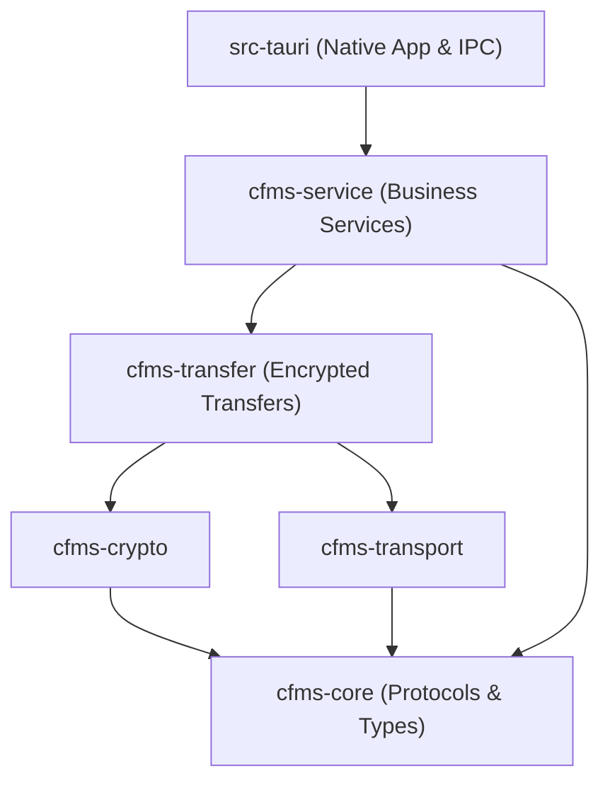

# Architecture and Dependency Conventions

## Frontend Architecture

### Layer Responsibilities and Dependency Boundaries

| Layer | Path | Core Responsibilities | Allowed Dependencies |
| --- | --- | --- | --- |
| **Routes** | `src/routes` | SvelteKit routing, framework configuration, and thin route adapter components. | `src/lib/app`, public root exports of `features`. |
| **Application** | `src/lib/app` | App shell, navigation, bootstrap lifecycle, native subscription management, and cross-domain orchestration workflows. | `features` (public exports), `api`, `shared`. Must not be referenced by lower layers or domain modules. |
| **Features** | `src/lib/features/<domain>` | Domain-specific UI, local state, business rules, and reusable controllers. | `api`, `shared`, public root exports of sibling features. No circular dependencies across domains. |
| **API** | `src/lib/api` | Named IPC invocations, native response adapters, and domain-partitioned wire DTOs. | Platform primitives and utilities only. Must not reference `app` or `features`. |
| **Shared** | `src/lib/shared` | Fluent UI components, theming, motion, internationalization, formatting, notifications, and platform bridge adapters. | Self-contained utilities. Must not contain business domain flows (auth, file operations, admin); must not reference `app` or `features`. |

### Domain Partitioning and Public Surface

Domain directories are partitioned under `src/lib/features`:

* `authentication`
* `connection`
* `files`
* `transfers`
* `access`
* `administration`
* `schedules`
* `settings`
* `updates`
* `diagnostics`

Each domain exposes a public entrypoint via its root export (`index.ts` or root `.svelte` components). Subdirectories are strictly internal implementation details. Cross-domain imports must target root entrypoints only (e.g., the `administration` feature must consume `AuthenticationManagement.svelte` instead of private sub-components from `features/authentication/components/editor/*`).

### View Orchestration and State Encapsulation

* **Composite Views:** Cross-domain screens reside in `src/lib/app/<domain>` to coordinate multiple underlying features.
* **Workflow Co-location:** Major pages (such as Files, Login, and Administration) co-locate `.svelte` view templates with adjacent `.svelte.ts` instance-level reactive workflows. Workflows expose state through explicit accessors; UI bindings target the workflow instance directly to prevent reactivity loss caused by premature destructuring.
* **Independent Business Rules:** Headless rules—including directory discovery, rate limiting, retry policies, and download queuing—remain encapsulated in `features/transfers` independent of UI lifecycle.
* **State Ownership:** State modules are strictly segregated by owner (`authentication`, `connection`, `upload`, `download`, and `shortcuts`). UI notifications and viewport metrics reside in `shared`. Clearing account state resets user-scoped transfer views to preserve session boundary semantics. A single monolithic global store is strictly prohibited.
* **Native Event Subscriptions:** `app/events.ts` orchestrates the registration, failure cleanup, and teardown of native event listeners. Individual domain `events.ts` modules interpret payloads and mutate their respective state. Shared UI components requiring navigation must rely on context or callbacks rather than importing concrete routing instances.
* **IPC Invocations:** `api.ts` and `api/types.ts` serve as entrypoints, with implementations organized by domain. Concrete invoke calls reside under `api/`, while platform-specific operations (file pickers, window controls, process handling, biometrics) are abstracted behind `shared/platform/native-*`.

## Native Backend (Rust)



### Crate Hierarchy and Boundaries

Dependencies flow downward strictly along the graph hierarchy:

* `cfms-crypto` and `cfms-transport` are mutually independent.
* `cfms-core` provides primitives and wire protocol definitions without referencing any internal workspace crates.
* Tauri dependencies and plugins are isolated exclusively within `src-tauri`.
* The division across the five internal library crates remains fixed.

### Native Subsystem Responsibilities

* **`src-tauri`:**
* `lib.rs` registers plugins and initializes the application container.
* `bootstrap.rs` configures runtime state, window lifecycles, and background services.
* `app_state.rs` maintains managed runtime state.
* `commands/registry.rs` performs explicit IPC registration using standard modules and named imports. Scope sharing via `include!` in application source is prohibited (except for build-time generated certificate authorities).
* Handles platform-specific features: OS credential stores, native file dialogs, Android plugin bindings, window management, and Tauri event emission.


* **`cfms-service`:**
* Segregates business engines by domain: `authentication`, `connection`, `files`, and `transfers`.
* `runtime` oversees background task lifecycles and structured cancellation tokens.
* `rpc` manages transport encryption, frame streaming, and generic response decoding.
* `session` returns sanitized session snapshots, explicitly excluding raw tokens, passphrases, or master secrets.
* Enforces domain logic independent of GUI runtimes: pagination mapping, upload path validation, and retry policies.


* **Error Handling:**
* Background services categorize failures using structured, strongly typed error enums to maintain deterministic retry policies.
* RPC errors retain execution-stage context, which the native adapter layer maps onto standardized IPC error strings and `CFMS_ERROR_DATA` structures.


## Architecture Verification

### Layering Rules

1. New functionality must identify its owning domain before introducing components, state, or test suites.
2. Cross-domain coordination belongs in `app`; universal presentation and system abstractions belong in `shared`. Monolithic shared state registries are forbidden.
3. IPC commands, server wire protocols, schema formats, and on-disk data structures remain stable across internal module reorganizations.

### Automated Checks

Run `pnpm check:architecture` to validate:

* Module resolutions across TypeScript and Svelte files, preventing cycles across files and business domains.
* Enforcement of clean layer boundaries: `shared` and `features` must not reference `app`.
* Cross-domain boundaries: modules cannot import private files inside sibling feature folders.
* Parity between IPC frontend call sites, command declarations, and Rust command registrations.
* Cargo workspace dependency graphs, including conditional compilation flags and test target dependencies.

### Standard Verification Suite

```powershell
# Frontend verification
pnpm check
pnpm test
pnpm test:shuffle
pnpm test:scripts
pnpm test:python
pnpm i18n:unused
pnpm build

# Rust workspace verification
cargo fmt --all -- --check
cargo clippy --workspace --all-targets --no-default-features --locked -- -D warnings
cargo test --workspace --no-default-features --locked -- --test-threads=4

```

> **Note:** During local development and CI check stages, Rust workspace checks run with default features disabled (`--no-default-features`) to bypass the bundled `custom-protocol` requirement and target the local `devUrl`, eliminating the need for a pre-built frontend distribution. Release pipelines re-enable default features to embed frontend assets.
