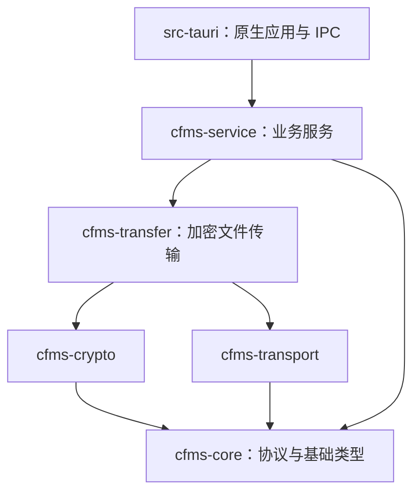

# 模块组织与依赖约定

## 前端

| 位置 | 职责 | 依赖约定 |
| --- | --- | --- |
| `src/routes` | SvelteKit 路由、框架配置及薄适配组件 | 调用应用组合或业务公开模块 |
| `src/lib/app` | 应用壳、导航、启动、原生订阅生命周期，以及跨业务页面和工作流 | 组合 features、api、shared；不被基础层或业务层反向引用 |
| `src/lib/features/<业务>` | 业务组件、状态、规则和可复用控制器 | 调用 api/shared；跨业务仅使用对方的根模块，且不能形成循环 |
| `src/lib/api` | 具名 IPC、原生响应适配和按业务分组的 wire DTO | 只依赖基础能力，不引用应用或业务实现 |
| `src/lib/shared` | Fluent UI、主题、动效、翻译、格式化、通知与平台能力 | 不包含账户、文件操作或管理流程；不依赖 app/features |

业务目录包括 authentication、connection、files、transfers、access、administration、schedules、settings、updates、diagnostics。每个目录根部的导出模块是可被其他业务使用的公开入口；子目录用于内部实现。例如认证策略编辑器的内部组件不能由管理业务直接导入，管理业务应使用 `AuthenticationManagement.svelte`。

页面放在 `app/<业务>`，因为它们组合多个业务。文件、登录和管理页面分别将视图与实例级响应式工作流放在相邻的 `.svelte`、`.svelte.ts` 文件；工作流通过访问器暴露状态，视图绑定始终指向该实例，避免解构响应式值导致失去更新。目录发现、限流重试、下载排队等可独立复用的规则继续放在 transfers 中，不需要依附页面。

状态按所有者存放：认证、连接、上传、下载、文件快捷方式各有自己的状态模块；通知与界面尺寸属于 shared。账户状态清理继续清理当前账户的传输视图，保持既有会话隔离语义。不存在全局业务状态聚合文件。

`app/events.ts` 负责原生监听器的安装、失败清理和释放，各业务的 `events.ts` 负责解释载荷并更新自己的状态。多次初始化共用同一次安装；释放后才完成的监听安装会立即取消。共享 UI 需要应用导航时使用导航上下文或回调，不导入应用路由实现。

`api.ts` 与 `api/types.ts` 是保留的 IPC 和 DTO 入口，具体实现按业务分组。新增 IPC 写入对应的 api 模块，类型放入 `api/types/<业务>.ts`；不要把业务状态或 UI 组件放进这些入口。平台事件、文件选择、窗口、进程和生物识别通过 `shared/platform/native-*` 适配入口调用，`invoke` 留在 api。

## Rust



允许直接依赖图中更底层的 crate；crypto 与 transport 彼此独立。core 不依赖其他内部 crate；Tauri 及其插件只能由原生应用引用。现有五个库 crate 的划分保持不变。

- 原生 `lib.rs` 装配插件和应用；`bootstrap.rs` 构建运行状态、窗口及后台服务；`app_state.rs` 保存原生应用状态。
- `commands/registry.rs` 显式注册 IPC，各命令模块使用普通 `mod` 和具名导入。源码不能通过 `include!` 共享作用域；构建期生成的 CA 清单仍可使用 `include!`。
- 命令 DTO 按连接、移动端、更新和传输组织。私有辅助项仅在确有调用方时开放至父模块；原生命令保持薄适配职责。
- service 的 authentication、connection、files、transfers 按业务归组；runtime 管理后台任务生命周期；rpc 负责敏感请求编码、流交换和泛型响应解析；session 输出不包含令牌或密钥的会话快照。
- RPC 错误保留失败阶段，由原生适配层转换为原有 IPC 错误文本和 `CFMS_ERROR_DATA`。后台服务继续使用结构化错误分类，避免因整理代码改变重试语义。
- OS 密钥存储、原生路径选择、Android 插件、窗口及 Tauri 事件发送留在原生层。目录分页转换、上传路径规则、重试规则等不依赖 Tauri 的逻辑放在 service。

## 修改与验证

新增功能先确定业务所有者，再添加组件、状态和测试。跨业务流程放在 app，通用基础能力放在 shared；不要通过新的全局 stores、helpers 或聚合入口掩盖依赖。

`pnpm check:architecture` 检查真实 TS/Svelte 导入、重导出、动态导入、类型导入、测试 mock 和 Worker URL，并校验：

- 本地引用可解析，基础层与业务层不反向依赖应用层。
- 跨业务调用不深入私有目录，文件依赖和业务依赖均无循环。
- 原生 SDK 调用位于适配入口，IPC 调用、命令声明与注册对应。
- Cargo 元数据中的内部依赖符合分层，包含测试依赖和平台条件依赖。

常规验收命令：

```powershell
pnpm check
pnpm test
pnpm test:architecture
pnpm test:i18n-unused
pnpm test:focus-styles
pnpm i18n:unused
pnpm build
cargo fmt --all -- --check
cargo clippy --workspace --all-targets --locked -- -D warnings
cargo test --workspace --locked -- --test-threads=4
```

生成脚本会读取主题和图标源文件，它们不是死代码；检查资源使用还必须覆盖动态翻译键、Worker、IPC、事件、条件编译和历史数据迁移。发布说明动画位于 `features/updates/release-highlights/animations`，生成脚本与测试使用同一位置。未经确认 TUN 模式，不运行 Gradle 验证。

本次整理不改变 IPC 命令、服务器协议、持久化字段或用户数据。已有历史迁移仍保留；内部路径已统一迁移，没有针对重构中间状态的兼容转发层。
